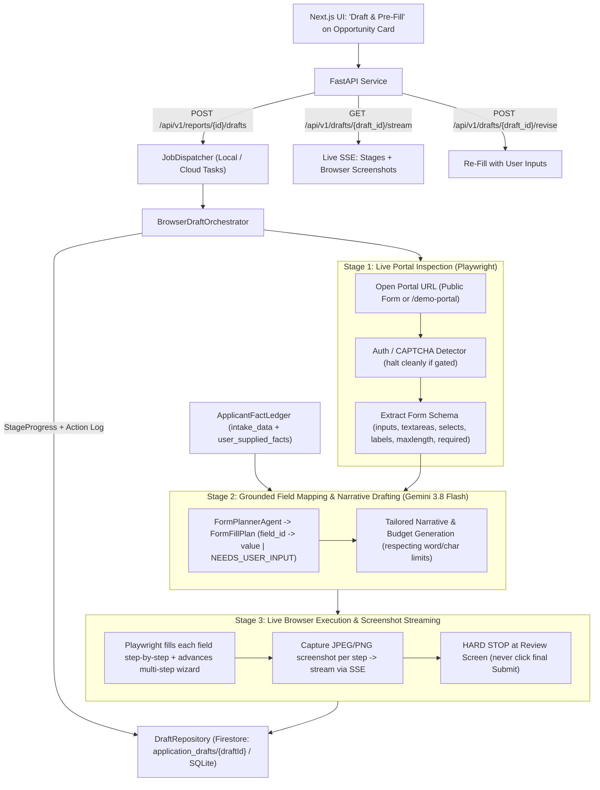

# Carthij Browser-Use Application Drafter Architecture Plan

## 1. Goal & Hackathon-Winning Value Proposition

Close the loop from **AI Funding Discovery → Live Browser-Assisted Application Pre-Fill**.

From any verified `FundingOpportunity` card on a completed `FundingReport`, the user clicks **"Draft & Pre-Fill Application"**. A **Playwright + Gemini 3.8 Flash Browser-Use Agent** opens the target grant portal, visually and structurally inspects the live form fields, drafts grounded answers from the user's intake, fills the form step-by-step while **streaming live screenshots and action logs** into the Carthij UI, flags missing facts (`EIN`, `UEI`, etc.), and **hard-stops before final Submit** for human review.

### Non-Negotiable Guardrails
1. **Zero Fabricated Applicant Facts (`ApplicantFactLedger`)**: Never invent EINs, SAM.gov UEIs, revenue, headcount, or impact metrics. Missing fields are flagged in `missing_inputs` and skipped or marked `[NEEDS USER INPUT: ...]` for human entry.
2. **Hard Stop Before Final Submit**: The browser agent may navigate multi-step forms and fill inputs, but **never clicks final Submit**. Final review and submission always require human approval.
3. **Never Bypass Auth, MFA, or CAPTCHAs**: If a portal presents a login wall, MFA prompt, or CAPTCHA, the agent immediately pauses with `status="awaiting_human_action"` and surfaces a screenshot + clear explanation.
4. **Stage-Proof Live Demo**: Works as a general-purpose browser agent on any public grant/accelerator form (Airtable, Typeform, Google Forms, foundation LOIs), AND ships with a realistic multi-step **Demo State Grant Portal** (`/demo-portal`) so live hackathon demos never fail on Login.gov MFA or CAPTCHAs.

---

## 2. End-to-End Architecture



---

## 3. Pipeline Stages in Detail

### Stage 1: Live Portal Inspection (`src/drafter/browser.py`)
1. **SSRF & URL Validation**: Before launching the browser, validate `target_portal_url` — allow only `http://` and `https://`, block link-local/metadata endpoints (`169.254.169.254`, `metadata.google.internal`), and block loopback/private IPs except the explicitly configured `DEMO_PORTAL_BASE_URL` (default `http://127.0.0.1:3000`).
2. **Bounded Shared Browser & `BrowserDriver` Protocol**:
   - Put browser interaction behind a `BrowserDriver` protocol: `PlaywrightBrowserDriver` (live Chromium, sharing a single lazily-initialized `Browser` guarded by `asyncio.Semaphore(2)` with isolated `browser.new_context(viewport={"width": 1280, "height": 800})` closed in `finally:`) and `SimulatedBrowserDriver` (deterministic fallback for CI/unit tests without Chromium binaries).
3. Navigate to `target_portal_url` (either user-supplied public form URL or local `/demo-portal?program=...`).
4. **Auth / CAPTCHA Check**: Detect password inputs, Login.gov/SSO redirects, or CAPTCHA iframes (`recaptcha`, `hcaptcha`, `turnstile`). If detected, stop immediately with `status="awaiting_human_action"` and attach the screenshot.
5. **DOM Form Extraction**: Run a clean Playwright JS evaluator to extract every visible form control:
   - `field_id` / `selector` (`#id`, `[name=...]`, or `data-testid`)
   - `tag` & `input_type` (`text`, `email`, `number`, `textarea`, `select`, `checkbox`, `radio`)
   - `label` (from `<label for=...>`, `aria-label`, `placeholder`, or nearest heading)
   - `required`, `maxlength`, and `options` (for `<select>` / radios)
   - Detected navigation buttons (`Next`, `Continue`, `Save Draft`, `Submit` — explicitly tagging `Submit` as **forbidden**).

### Stage 2: Grounded Field Mapping & Narrative Drafting (`src/drafter/mapper.py`)
- Input: `ExtractedFormSchema` + `ApplicantFactLedger` (`report.intake_data` + `user_supplied_facts`) + `FundingOpportunity` + relevant `SourceSummary` excerpts from the report.
- Output: typed `FormFillPlan` (`Gemini 3.8 Flash` with `response_schema=FormFillPlan`):
  - `actions: List[FieldFillAction]` (`selector`, `field_label`, `action_type`: `fill` | `select` | `check` | `skip_missing`, `value`, `reasoning`, `missing_input_question`).
  - `drafted_sections: List[DraftedSection]` (full drafted narratives for export/copying even outside the browser).
  - `missing_inputs: List[MissingInputField]` (e.g., `EIN`, `SAM.gov UEI`, `Authorized Signer`).
  - Enforces strict grounding: never fabricates tax IDs, financial history, or unverified metrics.

### Stage 3: Live Browser Pre-Fill & Screenshot Streaming (`src/drafter/orchestrator.py`)
- Iterates through `FormFillPlan.actions` in Playwright:
  1. Scrolls element into view and briefly highlights it with a blue outline so the screenshot clearly shows what the agent just filled.
  2. Uses native Playwright `page.locator(selector).fill(value)`, `select_option()`, and `check()` (never raw `el.value = ...`) so React 19 controlled inputs update state cleanly. Skips `skip_missing` fields and records them in `missing_inputs`.
  3. Captures a compressed JPEG screenshot (`quality=65`, ~30–60 KB) and calls `DraftRepository.append_browser_step(draft_id, step_meta, latest_screenshot_b64=...)` — appending metadata to `step_log` while **overwriting** the single `latest_screenshot_b64` field. That keeps the Firestore document `< 100 KB` at all times while enabling multi-instance repository-backed SSE to stream live frames!
  4. If a multi-step wizard has a safe `Next` / `Continue` button, clicks it, re-runs Stage 1 + Stage 2 on the next step (bounded to `max_steps=4`), and continues.
  5. **Hard Stop**: When a `Submit` / `Review` screen is reached, captures the final screenshot, clicks `Save Draft` only if explicitly available, and finishes with `status="ready_for_review"` (**never** clicks final Submit).

### Stage 4: Human-in-the-Loop Revision & Re-Fill (`POST /api/v1/drafts/{draft_id}/revise`)
- User inspects the live screenshots + filled field table + `missing_inputs` sidebar in the UI.
- User enters missing facts (e.g., `EIN: 12-3456789`, `UEI: ABC123DEF456`) and clicks **"Re-Run Pre-Fill with My Inputs"** — the agent re-runs with the enriched `ApplicantFactLedger` and fills the remaining blanks cleanly.

---

## 4. Stage-Proof Built-In Demo Grant Portal (`ui/app/demo-portal/page.tsx`)

To guarantee a 100% reliable live hackathon demo alongside real public portals, include a realistic 3-step **State Innovation & Workforce Grant Portal** inside the Next.js app:

- **Step 1 — Organization & Compliance**:
  - Stable `id` and `name` attributes on every React controlled input: Organization Legal Name (`#org_legal_name`), Organization Type (`#org_type`), Jurisdiction (`#jurisdiction`), Contact Email (`#contact_email`), **Federal EIN** (`#federal_ein` — *deliberately missing from intake so the agent flags it*), **SAM.gov UEI** (`#sam_uei` — *deliberately missing so the agent flags it*).
  - **Non-blocking wizard navigation**: Clicking **"Next: Proposal Narrative"** is allowed even when `EIN` / `UEI` are blank (marked *"Required before final submission — flagged on Review screen"*) so the browser agent smoothly reaches Step 2 on the first run to draft the narrative and budget!
- **Step 2 — Proposal Narrative & Budget**:
  - Target Program Name, Project Title, Executive Abstract (`textarea`, 250-word counter), Requested Funding Amount (USD), Budget & Use of Funds Breakdown (`textarea`), Eligibility & Non-Lobbying Attestation checkboxes.
- **Step 3 — Review & Submit**:
  - Summary of all filled fields + highlighted missing fields + a **Final Submit Application** button that the browser agent is hardcoded to **stop before clicking**.

---

## 5. Canonical Data Models (`src/models/draft.py`)

```python
class BrowserStepEvent(BaseModel):
    step_index: int
    stage: Literal["inspecting", "mapping", "filling", "advancing_step", "paused_for_review", "awaiting_human_action"]
    field_label: Optional[str] = None
    action: str                                # e.g. "Filled 'Project Abstract' (182 words)"
    status: Literal["ok", "skipped_missing", "blocked", "error"] = "ok"
    screenshot_b64: Optional[str] = None       # Streamed via SSE; NOT persisted in Firestore doc
    timestamp: float

class FilledFieldRecord(BaseModel):
    selector: str
    field_label: str
    value: Optional[str] = None
    status: Literal["filled", "skipped_missing", "error"]
    missing_question: Optional[str] = None

class MissingInputField(BaseModel):
    field_key: str
    question: str
    selector: Optional[str] = None
    user_answer: Optional[str] = None

class ApplicationDraft(BaseModel):
    draft_id: str
    report_id: str
    opportunity_name: str
    opportunity_source_url: str
    target_portal_url: str
    owner_uid: Optional[str] = None
    version: int = 1
    status: Literal["queued", "in_progress", "ready_for_review", "awaiting_human_action", "failed"] = "queued"
    filled_fields: List[FilledFieldRecord] = []
    missing_inputs: List[MissingInputField] = []
    drafted_narrative_markdown: Optional[str] = None
    user_supplied_facts: Dict[str, str] = {}
    step_log: List[Dict[str, Any]] = []        # Metadata-only log (no base64 blobs in Firestore!)
    latest_screenshot_b64: Optional[str] = None # Single compressed final thumbnail (<= 100 KB)
    stage_history: List[StageProgress] = []
    metadata: Dict[str, Any] = {}
    created_at: float
    updated_at: float
```

> [!IMPORTANT]
> **Firestore 1 MiB Guard + Multi-Instance SSE**: `DraftRepository.append_browser_step()` appends metadata-only entries to `step_log` (via `ArrayUnion`) and **overwrites** the single `latest_screenshot_b64` field with the newest compressed JPEG thumbnail (`<= 100 KB`). That guarantees the document stays well below 1 MiB at all times *and* lets repository-backed SSE (`GET /api/v1/drafts/{draft_id}/stream`) emit live screenshots across multiple Cloud Run instances with zero in-memory queue state.

---

## 6. API Surface, Firestore Rules & Deployment

### New API Endpoints
| Method & Path | Purpose |
| :--- | :--- |
| `POST /api/v1/reports/{report_id}/drafts` | Start a browser-use draft job for a chosen opportunity + `target_portal_url` (defaults to `/demo-portal` if omitted). Returns `202 Accepted` with `draft_id` + `stream_url`. |
| `GET /api/v1/reports/{report_id}/drafts` | List drafts associated with a report. |
| `GET /api/v1/drafts/{draft_id}` | Fetch canonical `ApplicationDraft`. |
| `GET /api/v1/drafts/{draft_id}/stream` | Live SSE streaming `stage`, `browser_step` (with live JPEG frames!), and terminal `complete`/`error` events. |
| `POST /api/v1/drafts/{draft_id}/revise` | Save user answers to `missing_inputs` and re-run the browser pre-fill to populate the previously skipped fields. |
| `GET /api/v1/drafts/{draft_id}/export` | Export the drafted narrative & field mappings as clean Markdown. |

### Firestore & Infra
- Collection: `application_drafts/{draftId}` + composite indexes `(report_id ASC, created_at DESC)` and `(owner_uid ASC, created_at DESC)`.
- **`firestore.rules`**: Updated via `firestore-rules-author` to enforce the same locked-down posture (`allow write: if false;` + owner-only authenticated reads).
- **Playwright Dependency**: Add `playwright>=1.49.0` (with `playwright install chromium`) in `[project.optional-dependencies] browser` and optionally use `mcr.microsoft.com/playwright/python` base image if deploying the browser worker to Cloud Run (2 GiB RAM).

---

## 7. Phased Implementation Plan (Hackathon-Fast)

1. **Draft Phase A — Models, Draft Repository & Demo Grant Portal**:
   - Create `src/models/draft.py` and `DraftRepository` (SQLite + Firestore) + update `firestore.rules` (via `firestore-rules-author`) and `firestore.indexes.json`.
   - Build the realistic 3-step **Demo Grant Portal** at `ui/app/demo-portal/page.tsx`.
2. **Draft Phase B — Playwright Browser-Use Agent & Grounded Form Mapper**:
   - Install Playwright (`chromium`) locally.
   - Implement `PortalInspector` (`src/drafter/browser.py`) with DOM schema extraction, Auth/CAPTCHA guard, element highlighting, step-by-step filling, and hard pre-Submit stop.
   - Implement `FormMapperAgent` (`src/drafter/mapper.py`) using Gemini 3.8 Flash + `ApplicantFactLedger`.
   - Wire `BrowserDraftOrchestrator` (`src/drafter/orchestrator.py`).
3. **Draft Phase C — FastAPI Endpoints & Live Screenshot SSE**:
   - Add `POST /api/v1/reports/{id}/drafts`, `GET /api/v1/drafts/{id}`, `GET /api/v1/drafts/{id}/stream`, `POST /api/v1/drafts/{id}/revise`, and `GET /api/v1/drafts/{id}/export`.
4. **Draft Phase D — Live Browser-Watch UI**:
   - Add **"Draft & Pre-Fill Application"** button on every `FundingOpportunity` card in `ResultsPanel.tsx`.
   - Build `/reports/[id]/drafts/[draftId]` showing the **live browser viewport feed** (updating per step via SSE!), action timeline, filled fields table, interactive `missing_inputs` form + **"Re-Fill with My Inputs"** button, and Markdown export.
