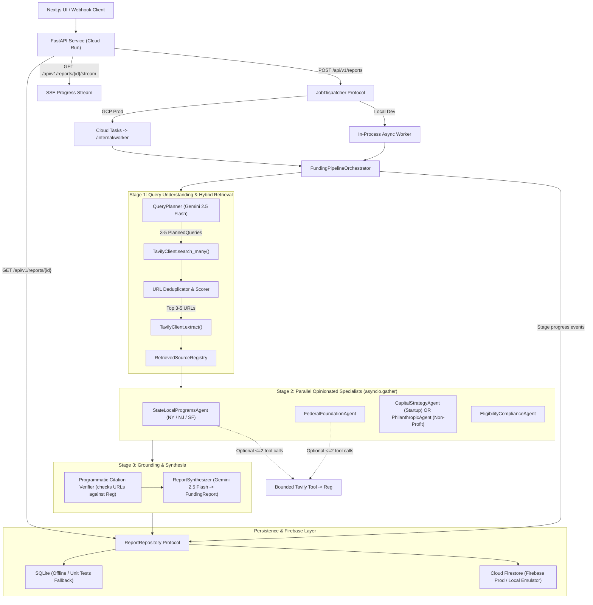

# Carthij Backend Architecture Plan

## 1. Architectural Principles

1. **Internal Pipeline, Minimal Public API**: `QueryPlanner`, `TavilyClient`, specialist agents, and grounding verifiers are internal modules—not public endpoints. The API exposes a clean job/report lifecycle with real-time progress streaming.
2. **Hybrid Retrieval (Fast Upfront + Bounded Agentic Follow-up)**:
   - Upfront parallel Tavily `/search` + selective `/extract` on top candidate URLs gives every specialist rich, grounded source text immediately.
   - Specialists also receive bounded `tavily_search` / `tavily_extract` tools (capped at 2 calls each) to verify missing deadlines, dollar caps, or eligibility rules.
3. **Opinionated Specialist Stages**: Replace dynamic LLM-invented subagent roles with a deterministic, well-crafted set of specialists routed by `organization_type` (`Startup` vs. `Non-Profit`) and `target_state` (`NY`, `NJ`, `SF`), each returning strict Pydantic schemas.
4. **Canonical Structured Output**: Every run produces a typed `FundingReport` (executive summary, structured `FundingOpportunity` cards, readiness gaps, prioritized action plan, and verified source registry).
5. **Strict Grounding & Citation Verification**: Every recommended program must cite a URL actually retrieved during the run. Programmatic post-verification flags or drops ungrounded claims and explicitly marks unknown deadlines as `"Unverified — check source"`.
6. **Google Cloud Native + Zero-Friction Local Dev**: Storage, job dispatch, and Gemini auth sit behind small Python protocols so local development runs with zero cloud dependencies (or optional Firestore Emulator) while GCP production deploys cleanly to Cloud Run + Firestore + Cloud Tasks + Vertex AI / Secret Manager.

---

## 2. System Architecture Diagram



---

## 3. Pipeline Stages in Detail

### Stage 1: Query Understanding & Upfront Retrieval (`src/pipeline/retrieval.py` + `src/agents/planner.py`)
1. **Query Understanding + Rewriting**: Gemini (`gemini-2.5-flash`, `response_schema=QueryPlan`) normalizes entity type, sector, stage, jurisdiction, key themes, and eligibility signals, then emits 3–5 targeted `PlannedQuery` objects.
2. **Parallel Tavily `/search`**: `TavilyClient.search_many()` fires all queries concurrently over a shared `httpx.AsyncClient` with `include_domains_mode="prefer"`, `time_range="year"`, and `include_published_date=True`.
3. **Deduplication & Selective Tavily `/extract`**:
   - Deduplicate URLs across all searches, rank by score + domain authority (`.gov`, `.org`, known agency domains).
   - Call Tavily `POST /extract` on the top 3–5 program URLs so specialists read actual eligibility criteria, award caps, and deadlines instead of truncated 350-char snippets.
4. **Source Registry**: Store every retrieved/extracted source in a `RetrievedSourceRegistry` (keyed by normalized URL with `source_id` like `SRC-1`, `SRC-2`, ...).

### Stage 2: Parallel Opinionated Specialists (`src/agents/specialists/`)
Instead of a second LLM planner inventing ad-hoc subagent names, `FundingPipelineOrchestrator` fans out a deterministic set of specialists in parallel via `asyncio.gather()`:

| Specialist | Runs For | Responsibility | Bounded Follow-up Tool |
| :--- | :--- | :--- | :--- |
| `StateLocalProgramsAgent` | All | State & municipal grants, tax credits, accelerators (NY: ESD/NYSTAR/NYSERDA/NYCEDC; NJ: NJEDA/NJCSIT; SF: CA Competes/OEWD/CalSEED) | Yes (`<= 2` Tavily calls) |
| `FederalFoundationAgent` | All | Federal grants (SBIR/STTR/NSF/NIH/DOE) & major national foundations | Yes (`<= 2` Tavily calls) |
| `CapitalStrategyAgent` | `Startup` | Equity/SAFE/venture/impact-loan benchmarks, investor readiness, non-dilutive stacking | Optional (`<= 1` call) |
| `PhilanthropicStrategyAgent` | `Non-Profit` | Foundation alignment, corporate sponsorships, fiscal sponsorship, multi-year grant strategy | Optional (`<= 1` call) |
| `EligibilityComplianceAgent` | All | Entity requirements (501(c)(3), SAM.gov/UEI, state nexus, matching funds, audit readiness, risk flags) | No (pure analysis on registry) |

- Any URL fetched by a specialist's follow-up tool is automatically registered in the shared `RetrievedSourceRegistry` (protected by an `asyncio.Lock` with deterministic monotonic `SRC-N` IDs and normalized URL deduplication so concurrent specialists never collide or duplicate entries).
- Each specialist returns a typed Pydantic output (`SpecialistFinding`) containing structured candidate `FundingOpportunity` items and `ReadinessGap` items.
- **Two-Phase `BaseAgent` Tool + Schema Execution**: To avoid cross-endpoint quirks between Gemini Developer API and Vertex AI when combining `tools` with `response_schema`, `BaseAgent.run()` runs tool-calling iterations with `tools` enabled (and `response_schema=None`, with the `<= 2` call cap enforced inside the tool wrapper itself), followed by a final structured turn with `response_schema` enabled (and `tools=None`).

### Stage 3: Programmatic Grounding & Canonical Synthesis (`src/pipeline/grounding.py` + `src/agents/synthesizer.py`)
1. **Programmatic Citation Verification**:
   - Check every candidate `FundingOpportunity.source_url` against `RetrievedSourceRegistry`.
   - Mark `citation_verified: bool` (`True` if exact/normalized URL is in registry).
   - Drop or quarantine any opportunity without a verified source URL so hallucinated programs never reach the final report.
   - Normalize missing deadlines/amounts to explicit `"Unverified — check source"` markers.
2. **Executive Synthesis**:
   - Deduplicate overlapping opportunities across specialists (e.g., if two specialists surfaced the same program).
   - Generate the final `FundingReport`: executive summary, overall readiness score, ranked `opportunities`, `readiness_gaps`, and prioritized `next_steps`.

---

## 4. Canonical Structured Report Schema (`src/models/report.py`)

```python
class FundingOpportunity(BaseModel):
    name: str
    provider: str                          # e.g. "Empire State Development", "NSF SBIR"
    scope: Literal["state", "local", "federal", "foundation", "private_capital"]
    instrument: str                        # e.g. "Grant", "Tax Credit", "SAFE / Equity", "Loan"
    estimated_amount: str                  # e.g. "$50,000 - $250,000" or "Unverified — check source"
    deadline: str                          # e.g. "Rolling", "2026-12-15", or "Unverified — check source"
    eligibility_fit: Literal["high", "medium", "low"]
    why_it_fits: str
    key_requirements: List[str]
    source_url: str
    source_id: str                         # Maps to RetrievedSourceRegistry (e.g. "SRC-3")
    citation_verified: bool = False

class ReadinessGap(BaseModel):
    category: Literal["compliance", "financial", "narrative", "jurisdiction", "eligibility"]
    severity: Literal["high", "medium", "low"]
    description: str
    remediation: str

class ActionItem(BaseModel):
    priority: int                          # 1 = highest
    timeframe: Literal["immediate_7d", "short_term_30d", "medium_term_90d"]
    action: str
    related_opportunity: Optional[str] = None

class StageProgress(BaseModel):
    stage: Literal[
        "queued",
        "query_planning",
        "searching",
        "extracting",
        "analyzing_specialists",
        "verifying_and_synthesizing",
        "completed",
        "failed",
    ]
    message: str
    timestamp: float

class FundingReport(BaseModel):
    report_id: str
    status: Literal["queued", "in_progress", "completed", "failed"]
    owner_uid: Optional[str] = None        # Top-level for Firestore rules & user scoping
    submitter_email: Optional[str] = None
    org_name: str
    org_type: str
    target_state: str
    intake_data: Dict[str, Any] = {}       # Preserved raw intake payload
    executive_summary: Optional[str] = None
    readiness_score: Optional[int] = None  # 0-100
    opportunities: List[FundingOpportunity] = []
    readiness_gaps: List[ReadinessGap] = []
    action_plan: List[ActionItem] = []
    specialist_outputs: List[Dict[str, Any]] = []
    sources: List[Dict[str, Any]] = []     # Metadata + truncated excerpts (<= 2,000 chars each)
    stage_history: List[StageProgress] = []
    metadata: Dict[str, Any] = {}          # query_understanding, tavily_credits_used, latency_ms
    created_at: float
    updated_at: float
```

---

## 5. API Surface (`src/api/app.py`)

| Method & Path | Purpose |
| :--- | :--- |
| `GET /api/v1/health` | Health check (Cloud Run liveness/readiness probe) |
| `POST /api/v1/reports` | Create a new funding evaluation job; persists `queued` record, dispatches async worker, returns `202` with `report_id` |
| `GET /api/v1/reports` | List reports (summary metadata) |
| `GET /api/v1/reports/{report_id}` | Fetch full structured `FundingReport` |
| `GET /api/v1/reports/{report_id}/stream` | Server-Sent Events (SSE) stream emitting `StageProgress` updates until `completed`/`failed` |
| `POST /internal/worker/execute` | Internal-only Cloud Tasks target (OIDC-authenticated on GCP; not exposed to public clients) |

- Remove the public `/api/v1/query-plan` endpoint (or gate it strictly behind `ENV=dev`).
- Keep `POST /api/v1/webhook/submit` temporarily as a thin compatibility wrapper while the Next.js UI migrates to `/api/v1/reports` + SSE.

---

## 6. Firebase & Google Cloud Deployment + Local Dev Parity

| Concern | Local Development | Firebase / GCP Production | Abstraction |
| :--- | :--- | :--- | :--- |
| **Backend Compute** | `uv run api` (`uvicorn --reload`) | **Cloud Run** (FastAPI container) | `Dockerfile` |
| **Frontend Hosting** | `npm run dev` (`ui/`) | **Firebase App Hosting** (Next.js SSR) | `apphosting.yaml` |
| **Database** | **Firebase Emulator Suite** (`FIRESTORE_EMULATOR_HOST`) or SQLite for unit tests | **Cloud Firestore** (existing Firebase DB) + `firestore.rules` | `ReportRepository` Protocol |
| **Async Job Queue** | In-process `asyncio.create_task` | **Cloud Tasks** -> `POST /internal/worker/execute` | `JobDispatcher` Protocol |
| **Auth (Optional/Next)** | Unauthenticated internal MVP (or Firebase Auth Emulator) | **Firebase Auth** (ID token verified in FastAPI middleware) | FastAPI dependency |
| **AI / LLM** | Gemini API (`GEMINI_API_KEY` in `.env`) | **Vertex AI** (`USE_VERTEXAI=true`, ADC / Service Account) | `src/core/client.py` (already supports both!) |
| **Secrets** | `.env` (gitignored) | **Secret Manager** mounted as Cloud Run env vars (`TAVILY_API_KEY`, etc.) | `os.getenv()` |

### Firestore Data Model (`reports/{reportId}`) & Concurrency Design
- Single top-level collection `reports/{reportId}` storing the canonical `FundingReport` document with top-level `owner_uid`, `submitter_email`, `intake_data`, `created_at`, and `updated_at` for clean sorting, filtering, and future `firestore.rules` ownership checks (`request.auth.uid == resource.data.owner_uid`).
- **1 MiB Document Size Guard**: Full raw markdown from Tavily `/extract` stays in memory during the pipeline run; `FundingReport.sources` persists only source metadata + truncated excerpts (`<= 2,000` chars per source). If full raw audit retention is needed later, store it in a `reports/{reportId}/sources/{sourceId}` subcollection.
- **Atomic Stage Progress**: `ReportRepository` exposes `append_stage_progress(report_id, stage_progress)` using `firestore.ArrayUnion` in Firestore (and atomic append in SQLite) rather than full-document overwrites, preventing lost updates during concurrent specialist runs.
- **Multi-Instance SSE Streaming**: `GET /api/v1/reports/{report_id}/stream` is backed by `ReportRepository` (Firestore `on_snapshot` listener or short-interval polling on `stage_history`/`status`), not an in-memory `asyncio.Queue`, so streaming works across multiple Cloud Run instances when Cloud Tasks dispatches `/internal/worker/execute` to a different container.
- All writes happen exclusively from the trusted FastAPI backend via `firebase-admin` / `google-cloud-firestore`.
- `firestore.rules` will default-deny all client writes (and deny client reads until Firebase Auth ownership is added, with the UI reading through FastAPI + SSE).

---

## 7. Phased Implementation Roadmap

1. **Phase 1 — Retrieval & Canonical Models**:
   - Add `TavilyClient.extract()` (`POST /extract`) to `src/core/tavily.py`.
   - Create `src/models/report.py` (canonical `FundingReport`, `FundingOpportunity`, `ReadinessGap`, `ActionItem`, `StageProgress`).
   - Add `RetrievedSourceRegistry` and upgrade `QueryPlanner` to run parallel search + selective extract.
   - Gate `/api/v1/query-plan` behind `CARTHIJ_DEV_TOOLS=true` (or keep internal-only).
2. **Phase 2 — Opinionated Specialists & Grounding**:
   - Upgrade `BaseAgent.run()` to two-phase execution (tool iterations without `response_schema`, followed by final structured extraction turn with `response_schema`) and enforce per-specialist tool budgets inside the tool wrapper.
   - Implement the 4 specialist agents in `src/agents/specialists/` with typed outputs and bounded Tavily follow-up tools.
   - Implement programmatic citation verifier + `ReportSynthesizer` in `src/pipeline/`.
   - Replace dynamic `CoordinatorAgent` with `FundingPipelineOrchestrator`.
3. **Phase 3 — Firestore Repository, Async Job API & SSE Streaming**:
   - Refactor `src/core/storage.py` into `ReportRepository` protocol (including atomic `append_stage_progress`) with `FirestoreReportRepository` (primary, works with both prod Firestore & Firebase Local Emulator) and `SQLiteReportRepository` (lightweight unit-test fallback).
   - Author `firestore.rules` and `firebase.json` (emulator config) for the `reports` collection.
   - Add `JobDispatcher` protocol (`LocalAsyncDispatcher` + `CloudTasksDispatcher`).
   - Add `POST /api/v1/reports` and `GET /api/v1/reports/{id}/stream` (SSE backed by `ReportRepository` for multi-instance Cloud Run safety).
4. **Phase 4 — Cloud Run + Firebase App Hosting & UI Upgrade**:
   - Add `Dockerfile` for Cloud Run and configure Firebase App Hosting for `ui/`.
   - Update Next.js UI to consume the structured `FundingReport` + SSE progress bar.
