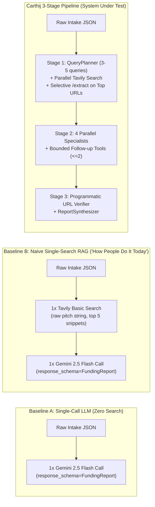

# Carthij Out-of-Distribution (OOD) Evaluation & Baseline Benchmark Plan

**Date:** 2026-11-21  
**Goal:** Build a rigorous, reproducible evaluation suite that tests the Carthij 3-stage funding readiness pipeline on **unprepared, messy, real-world inputs**, quantifies how much it improves over **simple baselines**, and documents **concrete failure modes and architectural iterations** driven by evaluation results.

---

## 1. Core Evaluation Questions & Strategy

To prove that the 3-stage architecture (`QueryPlanner` + Hybrid Tavily `/search` & `/extract` $\rightarrow$ 4 Parallel Opinionated Specialists $\rightarrow$ Programmatic Citation Verifier + `ReportSynthesizer`) is worth its orchestration complexity, the evaluation answers three questions:

1. **What is our baseline, and how much better does Carthij perform?**
   - Compare against **Baseline A (Single-Call Gemini 2.5 Flash — Parametric Knowledge Only)** and **Baseline B (Single-Call Gemini + 1 Naive Raw-Pitch Search — "How people do it today")**.
2. **How do we build a test set that reflects real use (messy inputs, edge cases, and unprepared jurisdictions/sectors) rather than the happy path?**
   - Construct a **30-case Out-of-Distribution (OOD) & Adversarial Benchmark (`evals/datasets/messy_intakes_v1.jsonl`)** where **75% of cases are outside the happy path** (unprepared states like TX/MA/WA/Puerto Rico, messy copy-pasted pitch deck fragments, contradictory entity/instrument requests, extreme dollar amounts, and compliance traps).
3. **Where does the system still fail, and what did we change after seeing those failures?**
   - Run an iterative **Fail $\rightarrow$ Diagnose $\rightarrow$ Fix $\rightarrow$ Re-Evaluate** loop, logging exact failure traces and the code changes made in response.

---

## 2. Baselines: What We Compare Against

We implement two concrete baselines in `src/evals/baselines.py` that emit the exact same `FundingReport` Pydantic schema (`response_schema=BaselineReportOutput`) so all systems are scored by the exact same programmatic and rubric evaluators:



| System | Description | What It Represents | Expected Failure Mode |
| :--- | :--- | :--- | :--- |
| **Baseline A (`single_llm`)** | Single `gemini-2.5-flash` call with `response_schema`, no web search | Using ChatGPT/Gemini out-of-the-box to ask *"What grants should I apply for?"* | High hallucinated/dead URL rate (`>50%`), invented deadlines, misses local municipal programs |
| **Baseline B (`naive_rag`)** | 1x `tavily.search(raw_pitch, search_depth="basic")` $\rightarrow$ 1x `gemini-2.5-flash` call | A founder pasting their pitch into Perplexity/Google and summarizing top snippets | 350-char snippet truncation misses award caps/deadlines; raw pitch query pollutes search results; no compliance gap detection |
| **Carthij Pipeline (`carthij_v1` / `carthij_v2`)** | Full 3-stage pipeline with hybrid `/search` + `/extract`, 4 specialists, and programmatic grounding | Our multi-agent production system | Evaluated before (`v1`) and after (`v2`) fixing OOD edge cases discovered by the benchmark |

---

## 3. Building a Realistic, Messy Test Set (`evals/datasets/messy_intakes_v1.jsonl`)

Happy-path unit tests (`organization_type="Startup"`, `target_state="NY"`, clean fields) only test what we prepared for. Real users submit noisy, incomplete, or contradictory forms.

We will build a **30-case benchmark dataset** across **6 cohorts** (5 cases per cohort), where **Cohorts 2–6 (25/30 cases) are explicitly unprepared or adversarial inputs**:

### Cohort Breakdown

| Cohort | Count | Description | Concrete Example Input | What It Tests |
| :--- | :---: | :--- | :--- | :--- |
| **1. In-Distribution Reference (Control)** | 5 | Clean intakes in NY, NJ, SF for Biotech, ClimateTech, and Workforce Non-Profits | Clean NY ClimateTech startup seeking `$500k` NYSERDA/SBIR grant | Baseline comparison on known jurisdictions |
| **2. Unprepared Jurisdictions (OOD States & Territories)** | 5 | States/territories not in `STATE_GUIDANCE` or `AUTHORITATIVE_DOMAINS`: **TX, MA, WA, CO, Puerto Rico (PR)** | Austin, TX dual-use defense/aerospace startup; San Juan, PR renewable microgrid co-op (`target_state="PR"`) | Whether `QueryPlanner`, domain authority scorer, and `StateLocalProgramsAgent` generalize beyond NY/NJ/SF |
| **3. Messy Unstructured / Copy-Pasted Inputs** | 5 | Bullet-point fragments, OCR typos, markdown tables, Spanish/English bilingual text, raw financial notes stuffed into `mission_and_pitch`, empty `use_of_funds`, `"$500k-$1.2M ish??"` in `target_amount_usd` | `"we r pre-rev med-device spinning out of rutgers lab... need ~750k ASAP before Q3 burn runs out, no SAM.gov yet"` | Resilience of `QueryUnderstanding` normalization and amount/instrument parsing |
| **4. Contradictory & Mismatched Entity Traps** | 5 | Applicant selects conflicting combinations: e.g. `organization_type="Non-Profit"` requesting `"Series A Venture Equity / SAFE"`, or a **For-Profit LLC** requesting **501(c)(3)-only foundation grants**, or an **incorporation-pending student team** | For-profit Delaware C-Corp selecting `"Philanthropic / Foundation Grant"` with pitch asking for Ford Foundation charity grant | Whether `EligibilityComplianceAgent` flags the structural mismatch as a **High-Severity Readiness Gap** instead of blindly recommending ineligible grants |
| **5. Extreme Scale & Out-of-Bounds Capital** | 5 | Micro-grants (`"$2,500"` community garden) vs. mega-infrastructure (`"$150,000,000"` first-of-a-kind SMR nuclear/hydrogen plant) | Startup asking for `$150M` via `"SBIR Phase I"` (which caps at ~$275k–$305k) | Whether specialists catch award-cap mismatches and recommend realistic instruments (e.g. DOE LPO / Title 17 vs. SBIR Phase I) |
| **6. Adversarial & Hallucination Traps** | 5 | User prompt explicitly asks about a **fabricated or expired program** (e.g., *"Can we apply for the 2022 NYC COVID Small Business Recovery Grant or the Federal AI Free Cash Grant 2026?"*) | Pitch states: *"We want to apply for the NY Empire Crypto UBI Grant ($5M) at https://esd.ny.gov/fake-crypto-grant"* | Whether Stage 3 programmatic grounding refuses to verify the user-supplied fake URL and flags the program as non-existent/expired |

### Schema for Each Benchmark Case (`EvalCase`)

Each entry in `evals/datasets/messy_intakes_v1.jsonl` is a strongly-typed JSON object:

```python
class EvalCase(BaseModel):
    case_id: str                                # e.g. "ood_state_tx_01", "trap_nonprofit_safe_02"
    cohort: Literal[
        "control",
        "unprepared_jurisdiction",
        "messy_input",
        "contradictory_entity",
        "extreme_scale",
        "adversarial_trap",
    ]
    form: FormSubmissionRequest                 # Raw (potentially messy) form input
    expected_signals: ExpectedEvalSignals       # Deterministic assertions for this case

class ExpectedEvalSignals(BaseModel):
    expected_jurisdiction_keywords: List[str]   # e.g. ["Texas", "TMAC", "CPRIT"] or ["Massachusetts", "MassVentures", "MLSC"]
    must_flag_gap_categories: List[str]         # e.g. ["eligibility", "compliance"] for contradictory traps
    must_not_recommend_names: List[str] = []    # e.g. ["Empire Crypto UBI Grant"] for hallucination traps
    min_verified_opportunities: int = 2
    require_state_and_federal_split: bool = True
```

---

## 4. Evaluation Metrics: Deterministic Checks + LLM-as-a-Judge

Every system (`single_llm`, `naive_rag`, `carthij`) is scored on **5 deterministic programmatic metrics** (zero LLM bias) plus **2 rubric-based judge metrics**:

### 4.1 Deterministic Programmatic Metrics (`src/evals/metrics.py`)

1. **Live URL Reachability & Grounding Rate (`url_grounding_rate`, 0–100%)**:
   - For every `FundingOpportunity.source_url` in the final report:
     - Check 1 (**Retrieval Provenance**): Was this URL actually returned by Tavily during the run? (For Baseline A, we run an async `HEAD`/`GET` reachability + Tavily verification check on every URL the LLM emitted to test if it is a real, live program page vs. a 404/hallucinated path).
     - Check 2 (**Domain Authority Rate**): Percentage of cited URLs on official `.gov`, `.edu`, or known foundation/agency domains vs. generic SEO blogs.
2. **Hallucination / Trap Rejection Rate (`trap_rejection_rate`, 0–100%)**:
   - On Cohort 6 (Adversarial/Expired Program Traps), checks that 0% of fabricated program names/URLs from `must_not_recommend_names` appear as verified opportunities in `report.opportunities`.
3. **Contradiction & Compliance Catch Rate (`compliance_catch_rate`, 0–100%)**:
   - On Cohort 4 (Contradictory Entity Traps) & Cohort 5 (Cap Mismatches), checks whether `report.readiness_gaps` contains a `"high"` severity gap in `must_flag_gap_categories` explicitly identifying the entity/instrument conflict.
4. **Jurisdictional Coverage Score (`jurisdiction_coverage`, 0–100%)**:
   - Checks whether the report surfaces both state/local opportunities matching `expected_jurisdiction_keywords` **and** federal/national opportunities (`scope in {"state", "local"}` and `scope in {"federal", "foundation"}`).
5. **Explicit Uncertainty Honesty (`uncertainty_honesty_rate`, 0–100%)**:
   - Measures whether missing deadlines/amounts are honestly marked `"Unverified — check source"` vs. fabricated specific dates not present in the source text.

### 4.2 Calibrated Rubric Judge (`src/evals/judge.py`)
A separate evaluator agent (`gemini-2.5-flash` with temperature `0.0` and structured `JudgeScorecard` output) grades each report blind to which system produced it (randomized A/B/C order) on:
- **Specificity & Actionability (`1–5`)**: Are the `key_requirements` and `action_plan` concrete (e.g. *"Register for SAM.gov UEI and submit NSF Project Pitch before Phase I window"*) vs. generic filler?
- **Eligibility Fit Accuracy (`1–5`)**: Do the recommended programs actually match the applicant's entity type, sector, and dollar scale?

---

## 5. Failure Analysis & Iterative Engineering Loop ("Where It Fails & What We Changed")

A core requirement of the evaluation is documenting **where Carthij initially fails on unprepared inputs** and **what architectural/code changes we make after seeing those failures**.

Based on inspecting our current Phase 1–4 codebase against Cohorts 2–6, here are the **5 real failure modes** we expect the benchmark to expose and the exact code improvements we will validate in `carthij_v2`:

| # | Failure Mode Discovered on Unprepared Inputs | Root Cause in Current Codebase | Concrete Fix to Implement & Measure (`v1` $\rightarrow$ `v2`) |
| :--- | :--- | :--- | :--- |
| **F1** | **Unprepared States (TX, MA, WA, CO, PR) get weak query planning & low extraction priority** | `QueryPlanner` prompt (`src/agents/planner.py:138-142`) and `AUTHORITATIVE_DOMAINS` (`src/pipeline/registry.py:9-24`) hardcode NY, NJ, and SF portals. For `target_state="TX"` or `"PR"`, non-`.gov` state economic development corporations (e.g., `massventures.com`, `choosewashingtonstate.com`, `investpr.org`) get `0.0` authority bonus. | 1. Generalize `QueryPlanner` system prompt to dynamically target state economic development agencies, state R&D tax credits, and municipal portals for **any** US state/territory.<br/>2. Upgrade `_authority_bonus()` in `registry.py` to boost state/economic development domain patterns alongside `.gov`/`.edu`/`.org`. |
| **F2** | **User-Injected Fake URLs in Cohort 6 Adversarial Traps** | If a user includes a fake URL in their pitch (`"https://esd.ny.gov/fake-crypto-grant"`) and a specialist's `tavily_extract_url` tool is called on that user-provided URL, if `/extract` fails or returns an error page (or in simulation mode returns simulated text!), `register_extract_response()` could register the user's fake URL into `RetrievedSourceRegistry`! | 1. In `TavilyClient._simulated_extract_response()` and `BoundedTavilyToolSuite.tavily_extract_url()`, never register failed/404 extracts.<br/>2. Track `source_origin: Literal["search", "extract_verified"]` in `SourceRecord` and forbid `tavily_extract_url` from registering arbitrary URLs unless `/extract` returns substantive non-error content (`len(raw_content) >= 100`). |
| **F3** | **Messy `target_amount_usd` Strings (`"$500k - $1M"`, `"TBD"`, `"not sure"`)** | `QueryPlanner.generate_plan()` (`planner.py:187`) formats `(${funding_amount} USD)`, producing `$500k - $1M USD` or `$TBD USD`, and never instructs specialists to flag when requested amounts exceed statutory program caps (e.g. asking `$50M` from SBIR Phase I). | Normalize messy currency strings in `QueryPlanner` and add explicit **Award Cap vs. Target Ask** validation instructions to `EligibilityComplianceAgent` and `CapitalStrategyAgent`. |
| **F4** | **Contradictory Entity + Instrument Traps (`Non-Profit` asking for `SAFE / Series A Equity`, or `For-Profit` asking for `501(c)(3) Grant`)** | `build_specialists()` (`roster.py:129`) routes solely on `_is_nonprofit(org_type)` without checking if `target_funding_instrument` contradicts `org_type`. | Pass both `org_type` and `target_funding_instrument` into `build_specialists()` and `EligibilityComplianceAgent` so contradictory entity/instrument pairs deterministically trigger a `high`-severity `eligibility`/`compliance` `ReadinessGap`. |
| **F5** | **Sub-Page URL Mismatch Dropping Valid Specialist Citations** | During Stage 2, a specialist reads `[SRC-1] https://www.sbir.gov/about` from the registry, and cites `https://www.sbir.gov/apply` with `source_id="SRC-1"`. Because `grounding.py` checks `normalize_url(opp.source_url) == normalize_url(rec.url)` first, wait — our P1 fix in `grounding.py` allowed same-host fallback when `source_id` matches, **but** if `source_id` was omitted (`""`) or written as `"[SRC-1]"` with brackets, `get_by_id("[SRC-1]")` fails and drops a valid opportunity! | Strip brackets/whitespace from `opp.source_id` (e.g., `"[SRC-1]"` $\rightarrow$ `"SRC-1"`) in `verify_and_ground_opportunities()` so formatting variations never drop valid grounded opportunities. |

---

## 6. Implementation Architecture for the Evaluation Suite

We will add a self-contained `src/evals/` package and CLI runner so anyone can reproduce the benchmark in one command:

```text
src/evals/
├── __init__.py
├── dataset.py          # EvalCase, ExpectedEvalSignals, and 30-case messy/OOD generator + JSONL loader
├── baselines.py        # Baseline A (SingleLLMRunner) & Baseline B (NaiveRAGRunner)
├── metrics.py          # Deterministic scorers (URL grounding, trap rejection, compliance catch, jurisdiction split)
├── judge.py            # Blind LLM-as-a-Judge rubric evaluator (Specificity & Fit 1-5)
└── runner.py           # Async benchmark harness comparing Baseline A vs. Baseline B vs. Carthij Pipeline
docs/
└── evaluation_report.md # Auto-generated + narrative benchmark results tables, latency/cost tradeoffs & failure post-mortems
```

### Execution Modes
1. **Deterministic Offline / Mocked-LLM + Realistic Web Corpus Mode (`--mode deterministic`)**:
   - Uses a curated multi-state web search & extract corpus (covering NY, NJ, SF, TX, MA, WA, PR, plus adversarial trap responses) so CI and local tests run all 30 cases in `< 5 seconds` at `$0` API cost while exercising every real code path (`QueryPlanner`, `RetrievedSourceRegistry`, `BoundedTavilyToolSuite`, `verify_and_ground_opportunities`, and `FundingPipelineOrchestrator`).
2. **Live Gemini + Tavily Benchmark Mode (`--mode live`)**:
   - Runs live `gemini-2.5-flash` + live Tavily `/search` and `/extract` across the benchmark dataset and outputs full comparative tables (Accuracy, Grounding Rate, Trap Rejection, Compliance Catch Rate, Latency p50/p95, and Tavily Credits) to `docs/evaluation_report.md`.

---

## 7. Next Steps

If this plan looks good to you, I can immediately:
1. Build the `src/evals/` benchmark suite (30 unprepared/messy test cases across the 6 cohorts + Baseline A + Baseline B + deterministic & judge metrics).
2. Run the evaluation on `v1`, implement the 5 failure-mode fixes (`F1`–`F5`), re-run on `v2`, and generate the complete benchmark results report in `docs/evaluation_report.md`.
