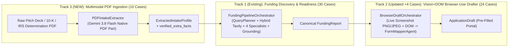

# Multimodal Gemini Sprint Evaluation Upgrade Plan (Track 3 PDF Ingestion + Track 2 Vision+DOM)

**Date:** 2026-11-21  
**Scope:** Evaluation plan covering the post-Phase A–D **Multimodal Gemini Sprint** changes documented in [development_log.md](./development_log.md#L155-L165):
1. **Native Multimodal PDF Pitch Deck Ingestion** (`src/agents/pdf_extractor.py`, `POST /api/v1/intake/extract-pdf`, `ui/components/IntakeForm.tsx`)
2. **Vision + DOM Browser-Use Form Mapping** (`src/drafter/mapper.py`, `src/drafter/orchestrator.py`)
3. **Custom Target Portal URL Support & End-to-End PDF $\rightarrow$ Fact Ledger Handoff** (`ui/components/ResultsPanel.tsx`, `src/drafter/mapper.py`)

---

## 1. Why the Evals Need Both a New Track (Track 3) and an Update to Track 2

With the Multimodal Sprint completed, Carthij now has **three distinct AI stages** across the user journey:

1. **What Stays Unchanged**:
   - **Track 1 (`src/evals/dataset.py`, 30 cases)**: Already tests `FundingPipelineOrchestrator` across 6 messy/OOD cohorts.
2. **What Needs to Be Updated in Track 2 (`src/evals/drafter_evals.py`, `20` $\rightarrow$ `24` cases)**:
   - In the Multimodal Sprint, `FormMapperAgent.plan_fill()` was upgraded to accept `screenshot_b64` (`data:image/jpeg;base64,...` or `data:image/png;base64,...`) and attach it as a native `types.Part.from_bytes` alongside `ExtractedFormSchema`.
   - We need to add **Cohort 6 (`vision_dom_disambiguation` — 4 cases)** to Track 2 to test portals where **DOM attributes alone are cryptic or unlabeled** (`label=""`, `selector="#input_field_1"`), proving that **Vision + DOM** outperforms a **DOM-Only Baseline** and that `verified_extra_facts` extracted from a PDF automatically flow into `ApplicantFactLedger` during Browser Pre-Fill.
3. **What Needs to Be Added as Track 3 (`src/evals/pdf_evals.py`, `10` new cases)**:
   - `PDFIntakeExtractor` (`POST /api/v1/intake/extract-pdf`) is a brand-new multimodal entry point that ingests raw PDFs (scanned slide decks, 2-column non-profit annual reports, SEC 10-Ks, and malformed files). We need a dedicated benchmark comparing **Baseline D (`naive_regex_pdf_scraper` — traditional text/regex scraping + unguarded single-call prompt)** against **Carthij Multimodal `PDFIntakeExtractor` (`v1` vs. `v2`)**.

---

## 2. Track 3 Design: Multimodal PDF Intake Extraction Benchmark (`src/evals/pdf_evals.py` — 10 Cases)

### 2.1 Baseline vs. System Under Test
- **Baseline D (`naive_regex_pdf_scraper`)**: Represents how legacy grant tools handle PDFs—scraping raw ASCII strings/regexes out of PDF streams and prompting a model without multimodal layout vision or anti-fabrication post-filtering.
  - *Failure modes*: Misses text inside scanned/image slides, mangles multi-column financial tables, guesses placeholder emails (`info@company.com`) or fake `federal_ein` when absent from the PDF, and crashes or passes garbage when given non-PDF files.
- **Carthij PDF Extractor `v1` (Pre-Hardening)**: `PDFIntakeExtractor` relying solely on the LLM prompt not to invent `contact_email` or `verified_extra_facts` when a pitch deck omits them, and without post-normalization when `mission_and_pitch` exceeds 900 chars or `target_funding_instrument` drifts slightly from the 6 canonical UI `<select>` options.
- **Carthij PDF Extractor `v2` (Hardened)**: Adds deterministic post-validation in `PDFIntakeExtractor.extract_from_bytes()`:
  1. Enforces `target_funding_instrument` membership in `FUNDING_INSTRUMENTS` (mapping synonyms to the exact `<select>` option so `IntakeForm.tsx` always binds cleanly).
  2. Truncates `mission_and_pitch` cleanly at `<= 900` chars.
  3. Strips placeholder/hallucinated values (`"TBD"`, `"N/A"`, `"unknown"`, `"00-0000000"`, `"XX-XXXXXXX"`) from `verified_extra_facts` and `contact_email`.
  4. Flattens `verified_extra_facts` (`List[ExtractedFactItem]`) into `build_applicant_fact_ledger()` in `src/drafter/mapper.py` so PDF-extracted `federal_ein` / `sam_uei` values automatically pre-fill portal forms in Track 2!

### 2.2 Track 3 Cohorts (`evals/datasets/pdf_intakes_v1.jsonl` — 10 Cases)

| Cohort | Cases | Test Input | What It Measures |
| :--- | :---: | :--- | :--- |
| **1. Multi-Page Pitch Decks & Real 10-K Filings (`pdf_deck_*`)** | 4 | 1. NY ClimateTech 10-slide PDF with embedded `federal_ein` & `sam_uei` in footer table 2. NJ 501(c)(3) Maternal Health Annual Report PDF (bilingual + IRS 990 table) 3. Real `data/apple_10k_report.pdf` (California / SF enterprise R&D filing) 4. Real `data/tesla_10k_report.pdf` (Clean energy / battery manufacturing 10-K) | **Field Extraction Accuracy** (`organization_name`, `organization_type`, `target_state`, `target_funding_instrument` enum validity, `mission_and_pitch <= 900` chars) & **Extra-Fact Recall** |
| **2. Scanned Image-Only & Missing-Identifier PDFs (`pdf_missing_*`)** | 3 | 1. Rasterized/scanned biotech slide deck with **no contact email, no EIN, no UEI** 2. Stealth startup 1-pager with `"EIN: Applied For / TBD"` and `"Revenue: Pre-Revenue"` 3. University spinout poster PDF with overflowing 2,500-char abstract | **Zero-Fabrication Rate**: Verifies `contact_email == ""` when absent and that `"TBD"` / `"Applied For"` is never injected into `verified_extra_facts` as a verified EIN |
| **3. Malformed, Spoofed & Oversized Payload Guards (`pdf_security_*`)** | 3 | 1. HTML file renamed to `pitch.pdf` (missing `%PDF` magic bytes) 2. Corrupted base64 string 3. `16 MiB` oversized payload (`> MAX_PDF_BYTES`) | **Security Gate Score**: Deterministic rejection via `decode_pdf_base64()` (`400 Bad Request`) before any Gemini API call |

---

## 3. Track 2 Upgrade: Vision + DOM Disambiguation & PDF-to-Portal Handoff (`+4` Cases $\rightarrow$ `24` Cases)

We add **Cohort 6 (`vision_dom_disambiguation` — 4 cases)** to `src/evals/drafter_evals.py`:

1. **`portal_vis_01_unlabeled_dom_inputs`**: Portal DOM has generic labels (`label="Field 1"`, `label="Field 2"`) while the attached `screenshot_b64` visual frame contains the section header and field instructions. Verifies `FormMapperAgent` attaches `extra_parts=[Part.from_bytes(..., mime_type="image/png")]` when `screenshot_b64` is provided.
2. **`portal_vis_02_visual_banner_numeric_format`**: Visual banner in screenshot specifies numeric formatting rules alongside DOM fields.
3. **`portal_vis_03_pdf_extracted_ein_handoff`**: End-to-end test where `report.intake_data["verified_extra_facts"] = [{"key": "federal_ein", "value": "12-3456789"}, {"key": "sam_uei", "value": "J8K9L2M4N6P8"}]` (exact output shape of `PDFIntakeExtractor`) is passed into `BrowserDraftOrchestrator`, verifying that Pass 1 automatically pre-fills `#federal_ein` and `#sam_uei` with **0 missing inputs**!
4. **`portal_vis_04_custom_external_portal_url`**: Tests custom external `target_portal_url` passed from `ResultsPanel.tsx` through SSRF validation and multimodal Vision+DOM inspection.

---

## 4. Implementation Steps

1. **Harden `PDFIntakeExtractor` (`src/agents/pdf_extractor.py`) & `build_applicant_fact_ledger` (`src/drafter/mapper.py`)**:
   - Add programmatic post-normalization on `ExtractedIntakeProfile` (strip `"TBD"`/`"N/A"`/`"unknown"` from `verified_extra_facts` and `contact_email`, clamp `mission_and_pitch` to `<= 900` chars, and normalize `target_funding_instrument` to `FUNDING_INSTRUMENTS`).
   - Flatten `intake_data.get("verified_extra_facts")` (when stored as `List[ExtractedFactItem]` or `List[dict]`) inside `build_applicant_fact_ledger()` so PDF-extracted facts are immediately available to `BrowserDraftOrchestrator`.
2. **Add Track 3 Benchmark (`src/evals/pdf_evals.py`) & Update Track 2 (`src/evals/drafter_evals.py`)**:
   - Implement the 10-case Track 3 PDF benchmark (including real bytes from `data/apple_10k_report.pdf` and `data/tesla_10k_report.pdf`) and the 4 new Cohort 6 Vision+DOM cases in Track 2.
3. **Update `src/evals/runner.py`, `tests/test_evals.py`, `docs/evaluation_report.md`, and `docs/hackathon_eval_slides.html`**:
   - Run all **64 total benchmark cases** (`30` Track 1 + `24` Track 2 + `10` Track 3) in one command and verify all unit + evaluation tests pass.
